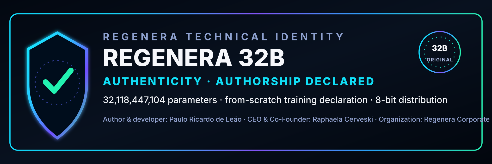

<div align="center">



<br>

# REGENERA 32B

### Modelo de Linguagem Autoral · 32.118.447.104 parâmetros

[](./assets/regenera-32b-technical-identity.svg)
[](#autoria-e-desenvolvimento)
[](#especificações-técnicas)
[](#especificações-técnicas)
[](#arquivos-do-modelo)

**Autor & Desenvolvedor · Paulo Ricardo de Leão**  ·  **CEO & Co-Founder · Raphaela Cerveski**  
**Concepção institucional · Paulo Ricardo de Leão e Raphaela Cerveski**  
**Organização · Regenera Corporate**

</div>

---

## Visão geral

O **Regenera 32B** é um modelo de inteligência artificial com **32.118.447.104 parâmetros**, desenvolvido para processamento avançado de linguagem natural, raciocínio, interpretação contextual e geração de respostas complexas.

O projeto declara desenvolvimento **a partir de inicialização aleatória dos parâmetros**, sem utilização de pesos pré-treinados de terceiros em qualquer etapa do treinamento.

> **Escopo do selo de autenticidade:** o selo no topo identifica tecnicamente este repositório e destaca a **declaração de autoria e origem do projeto**. Ele não deve ser interpretado como certificação independente de terceiros.

---

## Autoria e desenvolvimento

O Regenera 32B é um modelo de inteligência artificial de autoria e desenvolvimento integral de **Paulo Ricardo de Leão**, responsável pela:

- concepção técnica;
- arquitetura neural;
- implementação;
- preparação dos dados;
- tokenização;
- treinamento dos pesos;
- gerenciamento de memória e checkpoints;
- otimização;
- quantização;
- integração;
- validação e preparação dos artefatos de inferência.

A concepção institucional do projeto foi realizada em conjunto por **Paulo Ricardo de Leão** e **Raphaela Cerveski**, sob a organização da **Regenera Corporate**.

### Declaração de origem dos pesos

O desenvolvimento é declarado pelo projeto como realizado **do zero**, com inicialização aleatória dos parâmetros e **sem utilização de pesos pré-treinados de terceiros**.

Essa afirmação é apresentada como **declaração técnica de autoria do projeto**. Evidências criptográficas, históricos de execução, checkpoints, manifests, hashes, logs ou auditorias independentes devem ser tratados separadamente conforme forem incorporados ao repositório.

---

## Arquitetura e treinamento

O Regenera 32B foi estruturado para operações de linguagem natural e raciocínio, com:

- **62 camadas**;
- **Grouped Query Attention (GQA)**;
- **38 cabeças de atenção**;
- **8 cabeças de chave/valor**;
- **dimensão oculta de 4.864**;
- **FFN intermediária de 26.112**;
- **vocabulário de 98.560 tokens**;
- **contexto máximo configurado de 65.536 tokens**.

O processo de desenvolvimento compreendeu a construção da arquitetura, preparação do corpus, treinamento dos parâmetros, gerenciamento de memória e checkpoints, monitoramento computacional e preparação dos artefatos de inferência.

A versão distribuída utiliza **quantização afim de 8 bits**, com **grupos de 64 elementos**, e pesos organizados em **sete arquivos SafeTensors**.

---

## Especificações técnicas

| Componente | Especificação |
|---|---:|
| **Arquitetura** | Regenera-32B |
| **Parâmetros declarados** | **32.118.447.104** |
| **Camadas** | 62 |
| **Dimensão oculta** | 4.864 |
| **Dimensão intermediária FFN** | 26.112 |
| **Cabeças de atenção** | 38 |
| **Cabeças de chave/valor** | 8 |
| **Atenção** | Grouped Query Attention |
| **Tokenizer** | Byte-Level BPE |
| **Vocabulário** | 98.560 tokens |
| **Contexto máximo configurado** | 65.536 tokens |
| **Formato dos pesos** | SafeTensors |
| **Distribuição** | 7 shards |
| **Quantização** | Afim de 8 bits · grupos de 64 |

---

## Arquivos do modelo

### Configuração e tokenização

```text
config.json
generation_config.json
tokenizer_config.json
tokenizer.json
chat_template.jinja
model.safetensors.index.json
README.md
```

### Pesos

```text
model-00001-of-00007.safetensors
model-00002-of-00007.safetensors
model-00003-of-00007.safetensors
model-00004-of-00007.safetensors
model-00005-of-00007.safetensors
model-00006-of-00007.safetensors
model-00007-of-00007.safetensors
```

---

## Referência econômica de treinamento

Como **referência econômica projetada**, um treinamento de modelo dessa escala foi estimado em aproximadamente **R$ 38 milhões**, dentro de uma faixa indicativa de **R$ 31,8 milhões a R$ 44,1 milhões**, conforme as premissas utilizadas pelo projeto.

| Infraestrutura de referência | Preço de referência | Custo projetado |
|---|---:|---:|
| Together AI — H100 | US$ 3,99 / GPU-hora | R$ 31,8 milhões |
| Lambda — H100 | US$ 5,54 / GPU-hora | R$ 44,1 milhões |

> **Importante:** estes valores são **estimativas de infraestrutura computacional equivalente**, não despesas efetivamente comprovadas. O resultado depende de premissas de utilização, quantidade de GPU-horas, eficiência de treinamento, preços de provedores e câmbio.

---

## Proveniência e nível de evidência

| Informação | Natureza |
|---|---|
| Autoria de Paulo Ricardo de Leão | Declaração de autoria do projeto |
| Concepção com Raphaela Cerveski | Declaração institucional do projeto |
| Desenvolvimento a partir de inicialização aleatória | Declaração técnica do projeto |
| Ausência de pesos pré-treinados de terceiros | Declaração técnica do projeto |
| Arquitetura e hiperparâmetros | Especificações declaradas/documentadas |
| 32.118.447.104 parâmetros | Contagem declarada pelo projeto |
| R$ 31,8 mi – R$ 44,1 mi | Estimativa econômica de referência |
| ~R$ 38 mi | Valor central aproximado da estimativa |

Esta separação evita confundir **fato documentado**, **declaração de autoria**, **especificação técnica** e **estimativa econômica**.

---

## Identidade do projeto

```text
MODEL        REGENERA 32B
CLASS        Large Language Model
PARAMETERS   32,118,447,104
TRAINING     From-scratch declaration
WEIGHTS      SafeTensors · 7 shards
QUANTIZATION 8-bit affine · group size 64
CONTEXT      65,536 tokens
AUTHOR       Paulo Ricardo de Leão
CEO/COFOUNDER Raphaela Cerveski
CONCEPTION   Paulo Ricardo de Leão · Raphaela Cerveski
ORG          Regenera Corporate
```

---

## Repositório oficial

**https://github.com/regenera-enterprise/32B-REGENERA**

<div align="center">

### WE FUTURE. WE REGENERA.

**REGENERA 32B · ORIGINAL LANGUAGE MODEL PROJECT**

</div>
